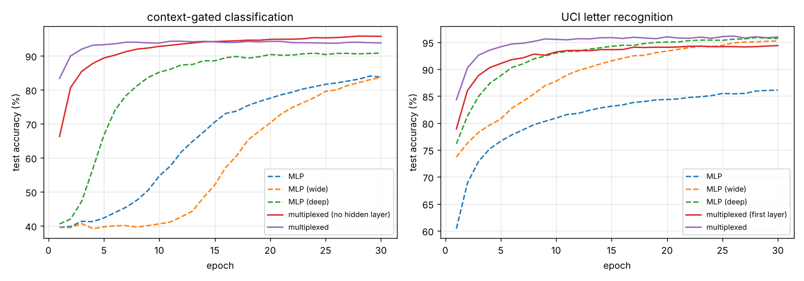

# Multiplexed neural networks

Two networks, where the layer activations of one (the *control* network) set the weights of the other (the *main* network) for every sample. The main network's weights are no longer constants. They become functions of the input, which makes this a hypernetwork, or multiplicative-interaction, model (Ha et al. 2016, *HyperNetworks*; Jayakumar et al. 2020, *Multiplicative Interactions and Where to Find Them*).

The code is header-only C++17 with no dependencies (`include/mnn/`). It has exact backpropagation, checked against finite differences, a training CLI and a benchmark against MLPs with the same parameter count.

## The model

The main network has sizes $n_0,\dots,n_L$, with $a_0 = x$ and $\tilde a_i = [a_i; 1]$. The control network has sizes $m_0 = n_0,\dots,m_{K-1}$ with $K \le L$, and $b_0 = x$:

$$b_{i+1} = \tanh\big(V_i^\top [b_i; 1]\big), \qquad
W^{\text{eff}}_i(x) = W_i + \sum_{l=1}^{m_i} b_{i,l}\, M_{i,l} \quad (i < K), $$

$$z_{i+1} = W^{\text{eff}}_i(x)^\top \tilde a_i, \qquad a_{i+1} = \tanh(z_{i+1}) \ \text{(hidden)}, \qquad \text{softmax}(z_L) \ \text{(output)} .$$

Every main layer $i < K$ has a weight tensor $M_i \in \mathbb R^{m_i \times (n_i+1) \times n_{i+1}}$, and control layer $i$ selects a mixture of its slices. Since $b_0 = x$, the first layer is bilinear in the input:

$$z_1 = W_0^\top \tilde x + \sum_l x_l\, M_{0,l}^\top \tilde x .$$

An MLP can only approximate such products. Deeper layers are modulated by learned features $b_i(x)$ instead.

**Backward pass.** Let $\delta_{i+1} = \partial \mathcal L / \partial z_{i+1}$. Then

$$\frac{\partial\mathcal L}{\partial W_i} = \tilde a_i \delta_{i+1}^\top, \qquad
\frac{\partial\mathcal L}{\partial M_{i,l}} = b_{i,l}\, \tilde a_i \delta_{i+1}^\top, \qquad
\frac{\partial\mathcal L}{\partial \tilde a_i} = W^{\text{eff}}_i \delta_{i+1}, \qquad
\frac{\partial\mathcal L}{\partial b_{i,l}} = \tilde a_i^\top M_{i,l}\, \delta_{i+1}.$$

The last term is backpropagated through the control network like an ordinary $\tanh$ MLP. The tests compare every gradient entry with central finite differences, to a relative error below $10^{-5}$.

## Results

Settings for every run: Adam with lr $10^{-3}$, batch 32, 30 epochs, three seeds, and Xavier initialisation. For $M$, the initial modulation has the variance of a single Xavier matrix. "Final" is the accuracy after the last epoch.



| task | model | main | control | parameters | test accuracy, final (3 seeds) |
|---|---|---|---|---|---|
| gated | MLP | 16-64-4 | – | 1348 | 83.77 ± 0.41 % |
| gated | MLP (wide) | 16-503-4 | – | 10567 | 83.62 ± 0.44 % |
| gated | MLP (deep) | 16-92-92-4 | – | 10492 | 90.82 ± 0.19 % |
| gated | **multiplexed (no hidden layer)** | 16-4 | 16 | **1156** | **95.75 ± 0.13 %** |
| gated | multiplexed | 16-32-4 | 16-8 | 10572 | 93.80 ± 0.28 % |
| letter | MLP | 16-32-26 | – | 1402 | 86.10 ± 0.30 % |
| letter | MLP (wide) | 16-397-26 | – | 17097 | 95.21 ± 0.18 % |
| letter | MLP (deep) | 16-128-96-26 | – | 17082 | 95.69 ± 0.14 % |
| letter | multiplexed (first layer) | 16-32-26 | 16 | 10106 | 94.38 ± 0.33 % |
| letter | **multiplexed** | 16-32-26 | 16-8 | 17106 | **95.95 ± 0.24 %** |

The full table, including best-epoch accuracy and run time, is in [`results/benchmark.md`](results/benchmark.md). The learning curves are in `results/curves.csv`.

**The context-gated task.**
- *Setup:* the input is $x = [e_c; v]$, where $e_c$ one-hot encodes one of 8 contexts and $v \sim \mathcal N(0, I_8)$. The label is $\arg\max_k (A_c v)_k$, with a random matrix $A_c$ for each context.
- *Why the multiplexed net fits:* the bilinear first layer can represent this exactly ($M_{0,c}$ holds $A_c$).
- *Result:* with 1156 parameters and no hidden layer it reaches 95.8 %. That beats every MLP here, including ones with 9× the parameters.

**UCI letter recognition.**
- *Setup:* the standard split (16000 train, 4000 test, features standardised).
- *Result:* with the same parameter count, the multiplexed net is level with the deep MLP: 95.95 ± 0.24 % vs 95.69 ± 0.14 %, a gap of about one standard deviation over three seeds. It is not clearly better.
- *Speed:* it gets there much faster: 93.5 % after 4 epochs, where the deep MLP is at 87.3 % and the wide one at 79.6 %.
- *Cost:* compute per sample is about one multiply-add per parameter for both model types.

## Build and run

```bash
sudo apt install doctest-dev        # only for the tests
make                                # mnn_train, mnn_bench
make test                           # gradient checks and training tests
./scripts/get_letter_data.sh        # UCI letter recognition -> letter-recognition.data

./mnn_train --task letter --main 16,32,26 --control 16,8 --epochs 30
./mnn_train --task letter --main 16,128,96,26              # plain MLP: no --control
./mnn_train --task gated  --main 16,4 --control 16 --csv curve.csv
./mnn_bench --epochs 30 --seeds 3 --out results            # the table above (about 4 min on one core)
python tools/plot_curves.py                                # docs/curves.png
```

CMake works too:

```bash
cmake -S . -B build && cmake --build build && ctest --test-dir build
```

Options of `mnn_train`:
- `--sgd` and `--momentum`: SGD with momentum instead of Adam
- `--weight-decay`
- `--mod-init`: scale of the initial modulation
- `--seed`

`--control` lists the control network's sizes. Its first entry is the input size, and it has one layer per modulated main layer.

```cpp
#include "mnn/data.hpp"

mnn::Config cfg;
cfg.main = {16, 32, 26};
cfg.control = {16, 8};      // modulate main layers 0 and 1
mnn::Model model(cfg);
mnn::Optimizer opt;          // Adam, lr 1e-3
mnn::Split data = mnn::loadLetters("letter-recognition.data");
mnn::train(model, opt, data, 30, 32, /*seed*/ 1, [](const mnn::EpochStats &e) { /* ... */ });
auto W = model.effectiveWeights(data.test.x[0], 0);   // the weights this sample sees
```

## History

The 2019 version (`Network.h`, `Node.h`, `main.cpp`, still in the git history) sketched the same architecture but didn't train it:
- **Labels:** they were always 0 (integer division), and the target was read from the wrong column.
- **Backprop:** it ignored the modulation in the main network's deltas, and the control network's gradient lacked the $\tilde a$ factor.
- **Batches:** the batch gradient used only the last sample.
- **Momentum:** it added node deltas instead of previous steps.
- **Initialisation:** all-positive initial weights saturated tanh.

The rewrite keeps the architecture and fixes the training.
